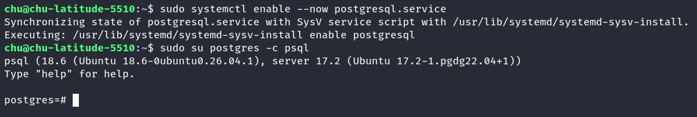
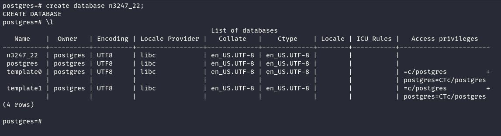

# POSTGRESQL BASIC DATABASE STRUCTURES CREATION LAB

## GIỚI THIỆU

Trong hệ quản trị cơ sở dữ liệu PostgreSQL, việc xây dựng các thành phần cấu trúc cơ bản là bước quan trọng để tổ chức, lưu trữ và quản lý dữ liệu.

Bài LAB này tập trung vào việc thực hành tạo và quản lý các đối tượng trong PostgreSQL, bao gồm:

- Database (Cơ sở dữ liệu)
- Schema (Lược đồ)
- Table (Bảng)
- Data Types (Kiểu dữ liệu)
- Composite Type (Kiểu dữ liệu tổng hợp)
- ENUM Type (Kiểu dữ liệu liệt kê)
- Domain (Miền dữ liệu)
- Sequence (Dãy số)
- Index (Chỉ mục)
- Constraints (Ràng buộc dữ liệu)
- View (Khung nhìn)

Thông qua bài thực hành, chúng ta sẽ hiểu cách tổ chức cấu trúc cơ sở dữ liệu, khai báo các kiểu dữ liệu, xây dựng chỉ mục và áp dụng các ràng buộc nhằm đảm bảo tính toàn vẹn của dữ liệu.

---

## 1. MỤC TIÊU

- Làm quen với công cụ dòng lệnh `psql` của PostgreSQL.
- Thực hành tạo và quản lý Database, Schema và Table.
- Sử dụng các kiểu dữ liệu cơ bản trong PostgreSQL.
- Tạo các kiểu dữ liệu tùy chỉnh: Composite, ENUM và Domain.
- Tìm hiểu cách sử dụng Sequence để sinh các giá trị số.
- Thực hành xây dựng các loại Index.
- Áp dụng các ràng buộc NOT NULL, UNIQUE, PRIMARY KEY và CHECK.
- Tạo View để truy xuất dữ liệu từ bảng.

---

## 2. MÔI TRƯỜNG THỰC HÀNH

| Thành phần | Mô tả |
|------------|-------|
| Hệ quản trị CSDL | PostgreSQL |
| Công cụ quản lý | psql |
| Ngôn ngữ | SQL |
| Hệ điều hành | Linux / Windows |
| Đối tượng thực hành | Database, Schema, Table, Index, View |
| Nội dung chính | Xây dựng cấu trúc cơ sở dữ liệu |

### Quy tắc đặt tên

Các đối tượng được đặt tên theo mẫu:

`mã_nhóm_số_thứ_tự_tên_đối_tượng`

Ví dụ:

- Database: `n3247_1`
- Schema: `n3247_1_schema_lab1`
- Table: `n3247_1_table_i5`
- Index: `n3247_1_idx1`
- View: `n3247_1_view`

**Lưu ý:** Thay `n3247_1` bằng mã nhóm và số thứ tự sinh viên tương ứng.

---

## 3. NỘI DUNG THỰC HÀNH

**1. KẾT NỐI ĐẾN CƠ SỞ DỮ LIỆU**

Kết nối đến cơ sở dữ liệu bằng công cụ `psql`.

**2. TẠO VÀ LỰA CHỌN CƠ SỞ DỮ LIỆU**

Tạo cơ sở dữ liệu theo mẫu:

`mã_nhóm_số_thứ_tự_sinh_viên`

Lựa chọn cơ sở dữ liệu theo mẫu `mã_nhóm_số_thứ_tự_sinh_viên`.

Ví dụ: `n3247_1`.

**3. TẠO SCHEMA MỚI**

Tạo một Schema mới trong cơ sở dữ liệu của mình với tên:

`mã_nhóm_số_thứ_tự_sinh_viên_schema_lab1`

**4. TẠO BẢNG TRONG CÁC SCHEMA**

Tạo bảng `mã_nhóm_số_thứ_tự_sinh_viên_tbl1` trong Schema mặc định và bảng `mã_nhóm_số_thứ_tự_sinh_viên_tbl2` trong Schema đã tạo ở nhiệm vụ 3.

**5. TẠO BẢNG VỚI CÁC KIỂU DỮ LIỆU CƠ BẢN**

Tạo bảng `mã_nhóm_số_thứ_tự_sinh_viên_table_i5` trong Schema của mình.

Từ nhiệm vụ này trở đi, tất cả các đối tượng phải được tạo trong Schema đã tạo ở nhiệm vụ 3.

Bảng phải sử dụng các thuộc tính với những kiểu dữ liệu sau:

- `INTEGER`
- `VARCHAR`
- `CHAR`
- `TIMESTAMP`
- `DATE`
- `BYTEA`

**6. TẠO BẢNG VỚI GIÁ TRỊ MẶC ĐỊNH VÀ KIỂU DỮ LIỆU INTERVAL**

Tạo bảng `mã_nhóm_số_thứ_tự_sinh_viên_table_i6`, trong đó có:

- Một thuộc tính thuộc kiểu dữ liệu bất kỳ được thiết lập giá trị mặc định.
- Một thuộc tính có kiểu dữ liệu khoảng thời gian (`INTERVAL`).

**7. TẠO KIỂU DỮ LIỆU TỔNG HỢP**

Tạo kiểu dữ liệu tổng hợp tùy chỉnh có tên:

`mã_nhóm_số_thứ_tự_sinh_viên_type`

Kiểu dữ liệu này dùng để mô tả các thuộc tính của một đối tượng nào đó, bao gồm các thuộc tính có kiểu dữ liệu:

- `REAL`
- `REAL`
- `DATE`
- `BYTEA`

**8. TẠO KIỂU DỮ LIỆU LIỆT KÊ**

Tạo kiểu dữ liệu liệt kê tùy chỉnh có tên:

`mã_nhóm_số_thứ_tự_sinh_viên_enum`

Kiểu dữ liệu này phải cho phép xác định mức phân loại kích thước theo ba giá trị:

- Lớn
- Trung bình
- Nhỏ

**9. TẠO DOMAIN VỚI ĐIỀU KIỆN KIỂM TRA**

Tạo một Domain tùy chỉnh có tên:

`mã_nhóm_số_thứ_tự_sinh_viên_domain`

Thiết lập điều kiện kiểm tra để đảm bảo giá trị trong Domain chỉ chứa đúng 3 chữ số.

**10. TẠO SEQUENCE**

Tạo một Sequence có tên:

`mã_nhóm_số_thứ_tự_sinh_viên_seq`

Yêu cầu:

- Giá trị bắt đầu: `1000`.
- Bước thay đổi: `-1`.

Dãy giá trị có dạng:

`1000, 999, 998, ...`

**11. TẠO INDEX TRÊN THUỘC TÍNH INTEGER**

Tạo một Index cho bảng ở nhiệm vụ 5 với tên:

`mã_nhóm_số_thứ_tự_sinh_viên_idx1`

Index được tạo trên thuộc tính có kiểu dữ liệu `INTEGER`.

**12. TẠO INDEX KẾT HỢP**

Tạo một Index kết hợp cho bảng ở nhiệm vụ 5 với tên:

`mã_nhóm_số_thứ_tự_sinh_viên_idx2`

Index được tạo trên hai thuộc tính có kiểu dữ liệu:

- `INTEGER`
- `DATE`

**13. TẠO INDEX THEO BIỂU THỨC**

Tạo một Index theo biểu thức cho bảng ở nhiệm vụ 5 với tên:

`mã_nhóm_số_thứ_tự_sinh_viên_idx3`

Index được tạo trên thuộc tính có kiểu dữ liệu `INTEGER`, sử dụng biểu thức chia lấy dư cho 10.

**14. TẠO INDEX MỘT PHẦN**

Tạo một Index một phần cho bảng ở nhiệm vụ 5 với tên:

`mã_nhóm_số_thứ_tự_sinh_viên_idx4`

Index được tạo trên thuộc tính có kiểu dữ liệu `INTEGER`, loại trừ các giá trị nhỏ hơn 100 và lớn hơn 1000.

**15. TẠO BẢNG VỚI RÀNG BUỘC NOT NULL**

Tạo một bảng có cấu trúc giống bảng ở nhiệm vụ 5, nhưng bổ sung ràng buộc `NOT NULL` trên trường có kiểu dữ liệu `CHAR`.

Tên bảng:

`mã_nhóm_số_thứ_tự_sinh_viên_notnull`

**16. TẠO BẢNG VỚI RÀNG BUỘC UNIQUE**

Tạo một bảng có cấu trúc giống bảng ở nhiệm vụ 5, nhưng bổ sung ràng buộc `UNIQUE` trên tổ hợp hai trường có kiểu dữ liệu:

- `CHAR`
- `INTEGER`

Tên bảng:

`mã_nhóm_số_thứ_tự_sinh_viên_unique`

**17. TẠO BẢNG VỚI RÀNG BUỘC PRIMARY KEY**

Tạo một bảng có cấu trúc giống bảng ở nhiệm vụ 5, nhưng bổ sung ràng buộc khóa chính (`PRIMARY KEY`) trên trường có kiểu dữ liệu `INTEGER`.

Tên bảng:

`mã_nhóm_số_thứ_tự_sinh_viên_pk`

**18. TẠO BẢNG VỚI RÀNG BUỘC CHECK**

Tạo một bảng có cấu trúc giống bảng ở nhiệm vụ 5, nhưng bổ sung ràng buộc `CHECK` trên trường có kiểu dữ liệu `VARCHAR` để kiểm tra sự tồn tại của ký tự `a`.

Tên bảng:

`mã_nhóm_số_thứ_tự_sinh_viên_check`

**19. TẠO VIEW**

Tạo một View có tên:

`mã_nhóm_số_thứ_tự_sinh_viên_view`

View lấy dữ liệu từ bảng ở nhiệm vụ 5 và chỉ hiển thị các thuộc tính có kiểu dữ liệu:

- `VARCHAR`
- `DATE`

## 4. THỰC HÀNH

### 1 – KẾT NỐI POSTGRESQL

Sử dụng công cụ dòng lệnh `psql` để kết nối đến hệ quản trị cơ sở dữ liệu PostgreSQL.

- Khởi động PostgreSQL.

```bash
sudo systemctl enable --now postgresql.service

```

- Kết nối đến PostgreSQL bằng `psql`.

```bash
sudo su postgres -c psql
```



### 2 – TẠO CƠ SỞ DỮ LIỆU

- Cú pháp tạo:

```bash
create database n3247_22;
```



>`\l` (viết tắt của list) là lệnh dùng để hiển thị danh sách tất cả cơ sở dữ liệu trên PostgreSQL Server

### BƯỚC 3 – TẠO SCHEMA

Tạo một Schema mới trong cơ sở dữ liệu với tên:

`mã_nhóm_số_thứ_tự_schema_lab1`

Ví dụ:

`n3247_1_schema_lab1`

Schema được sử dụng để quản lý và phân nhóm các đối tượng trong cơ sở dữ liệu.

**Lưu ý:** Kể từ bước 5, tất cả các đối tượng phải được tạo trong Schema này.

### BƯỚC 4 – TẠO BẢNG TRONG CÁC SCHEMA

Tạo hai bảng:

**Bảng thứ nhất:**

`mã_nhóm_số_thứ_tự_tbl1`

- Được tạo trong Schema mặc định của PostgreSQL.

**Bảng thứ hai:**

`mã_nhóm_số_thứ_tự_tbl2`

- Được tạo trong Schema đã thiết lập ở bước 3.

Mục đích là tìm hiểu cách quản lý các bảng thuộc những Schema khác nhau.

### BƯỚC 5 – TẠO BẢNG VỚI CÁC KIỂU DỮ LIỆU CƠ BẢN

Tạo bảng:

`mã_nhóm_số_thứ_tự_table_i5`

Bảng phải có các thuộc tính sử dụng những kiểu dữ liệu sau:

| Kiểu dữ liệu | Mô tả |
|-------------|-------|
| INTEGER | Số nguyên |
| VARCHAR | Chuỗi ký tự có độ dài thay đổi |
| CHAR | Chuỗi ký tự có độ dài cố định |
| TIMESTAMP | Ngày và thời gian |
| DATE | Ngày tháng |
| BYTEA | Dữ liệu nhị phân |

Mục tiêu là thực hành khai báo và sử dụng các kiểu dữ liệu cơ bản trong PostgreSQL.

### BƯỚC 6 – TẠO BẢNG VỚI DEFAULT VÀ INTERVAL

Tạo bảng:

`mã_nhóm_số_thứ_tự_table_i6`

Yêu cầu:

- Có ít nhất một thuộc tính sử dụng giá trị mặc định (`DEFAULT`).
- Có một thuộc tính sử dụng kiểu dữ liệu khoảng thời gian (`INTERVAL`).

Mục đích là tìm hiểu cơ chế tự động gán giá trị mặc định và lưu trữ khoảng thời gian trong PostgreSQL.

### BƯỚC 7 – TẠO KIỂU DỮ LIỆU TỔNG HỢP (COMPOSITE TYPE)

Tạo một kiểu dữ liệu tổng hợp với tên:

`mã_nhóm_số_thứ_tự_type`

Kiểu dữ liệu này dùng để mô tả các thuộc tính của một đối tượng và phải bao gồm:

- REAL
- REAL
- DATE
- BYTEA

Composite Type cho phép kết hợp nhiều thuộc tính có kiểu dữ liệu khác nhau thành một kiểu dữ liệu tùy chỉnh.

### BƯỚC 8 – TẠO KIỂU DỮ LIỆU LIỆT KÊ (ENUM)

Tạo một kiểu dữ liệu ENUM với tên:

`mã_nhóm_số_thứ_tự_enum`

Kiểu ENUM phải chứa ba giá trị biểu thị kích thước:

- Lớn (Large)
- Trung bình (Medium)
- Nhỏ (Small)

Mục tiêu là giới hạn giá trị dữ liệu trong một tập hợp các giá trị được định nghĩa trước.

### BƯỚC 9 – TẠO DOMAIN

Tạo một Domain với tên:

`mã_nhóm_số_thứ_tự_domain`

Yêu cầu:

- Domain chỉ chấp nhận giá trị chứa đúng 3 chữ số.
- Sử dụng điều kiện kiểm tra (`CHECK`) để xác thực dữ liệu.

Mục tiêu là thực hành định nghĩa miền dữ liệu tùy chỉnh với các điều kiện kiểm tra hợp lệ.

### BƯỚC 10 – TẠO SEQUENCE

Tạo một Sequence với tên:

`mã_nhóm_số_thứ_tự_seq`

Yêu cầu:

- Giá trị bắt đầu: `1000`
- Bước thay đổi: `-1`
- Các giá trị được sinh theo thứ tự giảm dần.

Ví dụ:

`1000 → 999 → 998 → 997 → ...`

Sequence được sử dụng để tự động sinh ra các giá trị số theo quy tắc xác định.

---

## 4. THỰC HÀNH TẠO INDEX

Trong phần này, sử dụng bảng đã tạo ở bước 5:

`mã_nhóm_số_thứ_tự_table_i5`

### 🔹 BƯỚC 11 – TẠO INDEX ĐƠN

Tạo Index với tên:

`mã_nhóm_số_thứ_tự_idx1`

Yêu cầu:

- Index được tạo trên thuộc tính có kiểu dữ liệu `INTEGER`.

Mục tiêu là tìm hiểu cách xây dựng chỉ mục trên một cột dữ liệu.

### 🔹 BƯỚC 12 – TẠO INDEX KẾT HỢP (COMPOSITE INDEX)

Tạo Index với tên:

`mã_nhóm_số_thứ_tự_idx2`

Yêu cầu:

- Index được xây dựng trên hai thuộc tính:
  - INTEGER
  - DATE

Mục tiêu là tìm hiểu cách tạo chỉ mục kết hợp trên nhiều cột.

### 🔹 BƯỚC 13 – TẠO INDEX THEO BIỂU THỨC (EXPRESSION INDEX)

Tạo Index với tên:

`mã_nhóm_số_thứ_tự_idx3`

Yêu cầu:

- Sử dụng thuộc tính kiểu `INTEGER`.
- Biểu thức Index là phép chia lấy dư cho 10.

Biểu thức:

`integer_column % 10`

Mục tiêu là thực hành tạo chỉ mục dựa trên kết quả của một biểu thức thay vì giá trị trực tiếp của cột.

### 🔹 BƯỚC 14 – TẠO PARTIAL INDEX

Tạo Index với tên:

`mã_nhóm_số_thứ_tự_idx4`

Yêu cầu:

- Index được tạo trên thuộc tính kiểu `INTEGER`.
- Loại trừ các giá trị nhỏ hơn 100.
- Loại trừ các giá trị lớn hơn 1000.

Điều kiện:

`integer_column >= 100 AND integer_column <= 1000`

Mục tiêu là tìm hiểu cách tạo chỉ mục trên một tập hợp con của dữ liệu theo điều kiện xác định.

---

## 5. THỰC HÀNH RÀNG BUỘC DỮ LIỆU

Các bảng trong phần này có cấu trúc và kiểu dữ liệu tương tự bảng ở bước 5, nhưng được bổ sung những ràng buộc khác nhau.

### 🔹 BƯỚC 15 – RÀNG BUỘC NOT NULL

Tạo bảng:

`mã_nhóm_số_thứ_tự_notnull`

Yêu cầu:

- Cấu trúc bảng tương tự bước 5.
- Thuộc tính kiểu `CHAR` phải có ràng buộc `NOT NULL`.

Mục tiêu là đảm bảo cột dữ liệu bắt buộc phải có giá trị khi thêm hoặc cập nhật bản ghi.

### 🔹 BƯỚC 16 – RÀNG BUỘC UNIQUE

Tạo bảng:

`mã_nhóm_số_thứ_tự_unique`

Yêu cầu:

- Cấu trúc bảng tương tự bước 5.
- Thiết lập ràng buộc `UNIQUE` trên tổ hợp hai thuộc tính:
  - CHAR
  - INTEGER

Mục tiêu là đảm bảo không có hai bản ghi có cùng tổ hợp giá trị trên hai cột được chỉ định.

### 🔹 BƯỚC 17 – RÀNG BUỘC PRIMARY KEY

Tạo bảng:

`mã_nhóm_số_thứ_tự_pk`

Yêu cầu:

- Cấu trúc bảng tương tự bước 5.
- Thiết lập khóa chính (`PRIMARY KEY`) trên thuộc tính kiểu `INTEGER`.

Mục tiêu là đảm bảo mỗi bản ghi có một giá trị định danh duy nhất và không được NULL.

### 🔹 BƯỚC 18 – RÀNG BUỘC CHECK

Tạo bảng:

`mã_nhóm_số_thứ_tự_check`

Yêu cầu:

- Cấu trúc bảng tương tự bước 5.
- Thiết lập ràng buộc `CHECK` trên thuộc tính kiểu `VARCHAR`.
- Giá trị của thuộc tính phải chứa ký tự `a`.

Mục tiêu là thực hành kiểm tra tính hợp lệ của dữ liệu trước khi được lưu vào bảng.

---

## 6. TẠO VIEW

### 🔹 BƯỚC 19 – TẠO KHUNG NHÌN (VIEW)

Tạo View với tên:

`mã_nhóm_số_thứ_tự_view`

Yêu cầu:

- Nguồn dữ liệu được lấy từ bảng ở bước 5.
- View chỉ hiển thị hai thuộc tính có kiểu dữ liệu:
  - VARCHAR
  - DATE

Mục tiêu là tìm hiểu cách tạo một khung nhìn để truy xuất một phần dữ liệu của bảng mà không cần tạo bảng lưu trữ dữ liệu độc lập.

---

## 7. KẾT QUẢ MONG ĐỢI

Sau khi hoàn thành bài LAB:

- Kết nối thành công PostgreSQL thông qua `psql`.
- Tạo được Database và Schema theo đúng quy tắc đặt tên.
- Tạo các bảng với đầy đủ kiểu dữ liệu được yêu cầu.
- Xây dựng được Composite Type, ENUM và Domain.
- Tạo Sequence với giá trị bắt đầu và bước thay đổi xác định.
- Tạo thành công bốn loại Index khác nhau.
- Thiết lập được các ràng buộc NOT NULL, UNIQUE, PRIMARY KEY và CHECK.
- Tạo View để truy xuất những thuộc tính được chỉ định.
- Hiểu được cách tổ chức và quản lý các đối tượng cơ bản trong PostgreSQL.

---

## 8. KIẾN THỨC ĐẠT ĐƯỢC

Thông qua bài thực hành này, chúng ta có thể:

1. **Quản lý cấu trúc cơ sở dữ liệu:** Tạo và tổ chức Database, Schema và Table.
2. **Làm việc với kiểu dữ liệu:** Sử dụng các kiểu dữ liệu có sẵn và tự định nghĩa kiểu dữ liệu mới.
3. **Tối ưu truy vấn:** Hiểu cách tạo chỉ mục đơn, chỉ mục kết hợp, chỉ mục theo biểu thức và chỉ mục có điều kiện.
4. **Đảm bảo tính toàn vẹn dữ liệu:** Áp dụng các ràng buộc để kiểm soát dữ liệu hợp lệ.
5. **Quản lý việc truy xuất dữ liệu:** Sử dụng View để biểu diễn những thông tin cần thiết từ bảng.

---

## 9. KẾT LUẬN

Bài LAB **PostgreSQL Basic Database Structures Creation** giúp củng cố kiến thức nền tảng về thiết kế và quản trị cơ sở dữ liệu quan hệ.

Việc thực hành các thao tác tạo Database, Schema, Table, Data Type, Sequence, Index, Constraint và View là cơ sở để tiếp tục nghiên cứu những nội dung nâng cao như:

- Quản trị và bảo mật cơ sở dữ liệu.
- Tối ưu hóa hiệu năng truy vấn SQL.
- Quản lý người dùng và phân quyền truy cập.
- Sao lưu và phục hồi dữ liệu.
- Giám sát và đảm bảo tính toàn vẹn của dữ liệu.
