# POSTGRESQL BASIC DATABASE STRUCTURES CREATION LAB

## GIỚI THIỆU

Bài LAB này tập trung vào việc thực hành tạo và quản lý các đối tượng trong PostgreSQL, bao gồm:

- Database (Cơ sở dữ liệu)
- Schema (Lược đồ)
- Table (Bảng)
- Data Types (Kiểu dữ liệu)
- Composite Type (Kiểu dữ liệu tổng hợp)
- ENUM Type (Kiểu dữ liệu liệt kê)
- Domain (Miền dữ liệu)
- Sequence (Dãy số)
- Index (Chỉ mục)
- Constraints (Ràng buộc dữ liệu)
- View (Khung nhìn)

---

## 1. MỤC TIÊU

- Làm quen với công cụ dòng lệnh `psql` của PostgreSQL.
- Thực hành tạo và quản lý Database, Schema và Table.
- Sử dụng các kiểu dữ liệu cơ bản trong PostgreSQL.
- Tạo các kiểu dữ liệu tùy chỉnh: Composite, ENUM và Domain.
- Tìm hiểu cách sử dụng Sequence để sinh các giá trị số.
- Thực hành xây dựng các loại Index.
- Áp dụng các ràng buộc NOT NULL, UNIQUE, PRIMARY KEY và CHECK.
- Tạo View để truy xuất dữ liệu từ bảng.

---

## 2. MÔI TRƯỜNG THỰC HÀNH

| Thành phần | Mô tả |
|------------|-------|
| Hệ quản trị CSDL | PostgreSQL |
| Công cụ quản lý | psql |
| Ngôn ngữ | SQL |
| Hệ điều hành | Linux / Windows |
| Đối tượng thực hành | Database, Schema, Table, Index, View |
| Nội dung chính | Xây dựng cấu trúc cơ sở dữ liệu |

**Quy tắc đặt tên**

Các đối tượng được đặt tên theo mẫu:

`mã_nhóm_số_thứ_tự_tên_đối_tượng`

Ví dụ:

- Database: `n3247_1`
- Schema: `n3247_1_schema_lab1`
- Table: `n3247_1_table_i5`
- Index: `n3247_1_idx1`
- View: `n3247_1_view`

---

## 3. NHIỆM VỤ

**1. KẾT NỐI ĐẾN CƠ SỞ DỮ LIỆU**

Kết nối đến cơ sở dữ liệu bằng công cụ `psql`.

**2. TẠO VÀ LỰA CHỌN CƠ SỞ DỮ LIỆU**

Tạo cơ sở dữ liệu theo mẫu:

`mã_nhóm_số_thứ_tự_sinh_viên`

Lựa chọn cơ sở dữ liệu theo mẫu `mã_nhóm_số_thứ_tự_sinh_viên`.

Ví dụ: `n3247_1`.

**3. TẠO SCHEMA MỚI**

Tạo một Schema mới trong cơ sở dữ liệu của mình với tên:

`mã_nhóm_số_thứ_tự_sinh_viên_schema_lab1`

**4. TẠO BẢNG TRONG CÁC SCHEMA**

Tạo bảng `mã_nhóm_số_thứ_tự_sinh_viên_tbl1` trong Schema mặc định và bảng `mã_nhóm_số_thứ_tự_sinh_viên_tbl2` trong Schema đã tạo ở nhiệm vụ 3.

**5. TẠO BẢNG VỚI CÁC KIỂU DỮ LIỆU CƠ BẢN**

Tạo bảng `mã_nhóm_số_thứ_tự_sinh_viên_table_i5` trong Schema của mình.

Từ nhiệm vụ này trở đi, tất cả các đối tượng phải được tạo trong Schema đã tạo ở nhiệm vụ 3.

Bảng phải sử dụng các thuộc tính với những kiểu dữ liệu sau:

- `INTEGER`
- `VARCHAR`
- `CHAR`
- `TIMESTAMP`
- `DATE`
- `BYTEA`

**6. TẠO BẢNG VỚI GIÁ TRỊ MẶC ĐỊNH VÀ KIỂU DỮ LIỆU INTERVAL**

Tạo bảng `mã_nhóm_số_thứ_tự_sinh_viên_table_i6`, trong đó có:

- Một thuộc tính thuộc kiểu dữ liệu bất kỳ được thiết lập giá trị mặc định.
- Một thuộc tính có kiểu dữ liệu khoảng thời gian (`INTERVAL`).

**7. TẠO KIỂU DỮ LIỆU TỔNG HỢP**

Tạo kiểu dữ liệu tổng hợp tùy chỉnh có tên:

`mã_nhóm_số_thứ_tự_sinh_viên_type`

Kiểu dữ liệu này dùng để mô tả các thuộc tính của một đối tượng nào đó, bao gồm các thuộc tính có kiểu dữ liệu:

- `REAL`
- `REAL`
- `DATE`
- `BYTEA`

**8. TẠO KIỂU DỮ LIỆU LIỆT KÊ**

Tạo kiểu dữ liệu liệt kê tùy chỉnh có tên:

`mã_nhóm_số_thứ_tự_sinh_viên_enum`

Kiểu dữ liệu này phải cho phép xác định mức phân loại kích thước theo ba giá trị:

- Lớn
- Trung bình
- Nhỏ

**9. TẠO DOMAIN VỚI ĐIỀU KIỆN KIỂM TRA**

Tạo một Domain tùy chỉnh có tên:

`mã_nhóm_số_thứ_tự_sinh_viên_domain`

Thiết lập điều kiện kiểm tra để đảm bảo giá trị trong Domain chỉ chứa đúng 3 chữ số.

**10. TẠO SEQUENCE**

Tạo một Sequence có tên:

`mã_nhóm_số_thứ_tự_sinh_viên_seq`

Yêu cầu:

- Giá trị bắt đầu: `1000`.
- Bước thay đổi: `-1`.

Dãy giá trị có dạng:

`1000, 999, 998, ...`

**11. TẠO INDEX TRÊN THUỘC TÍNH INTEGER**

Tạo một Index cho bảng ở nhiệm vụ 5 với tên:

`mã_nhóm_số_thứ_tự_sinh_viên_idx1`

Index được tạo trên thuộc tính có kiểu dữ liệu `INTEGER`.

**12. TẠO INDEX KẾT HỢP**

Tạo một Index kết hợp cho bảng ở nhiệm vụ 5 với tên:

`mã_nhóm_số_thứ_tự_sinh_viên_idx2`

Index được tạo trên hai thuộc tính có kiểu dữ liệu:

- `INTEGER`
- `DATE`

**13. TẠO INDEX THEO BIỂU THỨC**

Tạo một Index theo biểu thức cho bảng ở nhiệm vụ 5 với tên:

`mã_nhóm_số_thứ_tự_sinh_viên_idx3`

Index được tạo trên thuộc tính có kiểu dữ liệu `INTEGER`, sử dụng biểu thức chia lấy dư cho 10.

**14. TẠO INDEX MỘT PHẦN**

Tạo một Index một phần cho bảng ở nhiệm vụ 5 với tên:

`mã_nhóm_số_thứ_tự_sinh_viên_idx4`

Index được tạo trên thuộc tính có kiểu dữ liệu `INTEGER`, loại trừ các giá trị nhỏ hơn 100 và lớn hơn 1000.

**15. TẠO BẢNG VỚI RÀNG BUỘC NOT NULL**

Tạo một bảng có cấu trúc giống bảng ở nhiệm vụ 5, nhưng bổ sung ràng buộc `NOT NULL` trên trường có kiểu dữ liệu `CHAR`.

Tên bảng:

`mã_nhóm_số_thứ_tự_sinh_viên_notnull`

**16. TẠO BẢNG VỚI RÀNG BUỘC UNIQUE**

Tạo một bảng có cấu trúc giống bảng ở nhiệm vụ 5, nhưng bổ sung ràng buộc `UNIQUE` trên tổ hợp hai trường có kiểu dữ liệu:

- `CHAR`
- `INTEGER`

Tên bảng:

`mã_nhóm_số_thứ_tự_sinh_viên_unique`

**17. TẠO BẢNG VỚI RÀNG BUỘC PRIMARY KEY**

Tạo một bảng có cấu trúc giống bảng ở nhiệm vụ 5, nhưng bổ sung ràng buộc khóa chính (`PRIMARY KEY`) trên trường có kiểu dữ liệu `INTEGER`.

Tên bảng:

`mã_nhóm_số_thứ_tự_sinh_viên_pk`

**18. TẠO BẢNG VỚI RÀNG BUỘC CHECK**

Tạo một bảng có cấu trúc giống bảng ở nhiệm vụ 5, nhưng bổ sung ràng buộc `CHECK` trên trường có kiểu dữ liệu `VARCHAR` để kiểm tra sự tồn tại của ký tự `a`.

Tên bảng:

`mã_nhóm_số_thứ_tự_sinh_viên_check`

**19. TẠO VIEW**

Tạo một View có tên:

`mã_nhóm_số_thứ_tự_sinh_viên_view`

View lấy dữ liệu từ bảng ở nhiệm vụ 5 và chỉ hiển thị các thuộc tính có kiểu dữ liệu:

- `VARCHAR`
- `DATE`

## 4. THỰC HÀNH

### 1 – KẾT NỐI POSTGRESQL

Sử dụng công cụ dòng lệnh `psql` để kết nối đến hệ quản trị cơ sở dữ liệu PostgreSQL.

- Khởi động PostgreSQL.

```bash
sudo systemctl enable --now postgresql.service

```

- Kết nối đến PostgreSQL bằng `psql`.

```bash
sudo su postgres -c psql
```


### 2 – TẠO CƠ SỞ DỮ LIỆU

- Cú pháp tạo:

```sql
create database n3247_22;
```


>`\l` (viết tắt của list) là lệnh dùng để hiển thị danh sách tất cả cơ sở dữ liệu trên PostgreSQL Server

### 3 – TẠO SCHEMA

Schema được sử dụng để quản lý và phân nhóm các đối tượng trong cơ sở dữ liệu.

- Kết nối đến cơ sở dữ liệu:

```sql
\c n3247_22;
```

>\c: Viết tắt của \connect, dùng để kết nối hoặc chuyển sang một cơ sở dữ liệu khác.

- Tạo Schema mới:

```sql
CREATE SCHEMA n3247_22_schema_lab1;
```

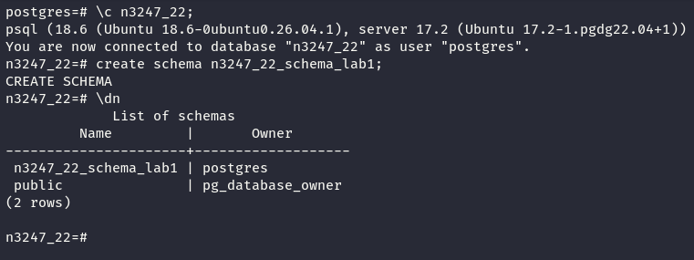

> \dn: Lệnh trong psql dùng để liệt kê các Schema trong cơ sở dữ liệu hiện tại.

### 4 – TẠO BẢNG TRONG CÁC SCHEMA

**Bảng thứ nhất:**

```sql
CREATE TABLE n3247_22_tbl1();
```

- Được tạo trong Schema mặc định của PostgreSQL.

**Bảng thứ hai:**

```sql
CREATE TABLE n3247_22_schema_lab1.n3247_22_tbl2();
```

- Được tạo trong Schema đã thiết lập ở bước 3.

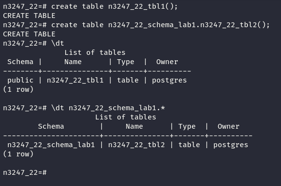

> \dt: Lệnh trong psql dùng để liệt kê các bảng thuộc những Schema được hiển thị theo search_path.

- Kiểm tra bảng trong Schema cụ thể

```sql
\dt n3247_22_schema_lab1.*
```

### 5 – TẠO BẢNG VỚI CÁC KIỂU DỮ LIỆU CƠ BẢN

Tạo bảng:

```sql
CREATE TABLE n3247_22_schema_lab1.n3247_22_table_i5(
    id INT,
    fullName VARCHAR,
    country CHAR,
    testing TIMESTAMP,
    dateOfBirth DATE,
    files BYTEA
);
```

Giải thích:

- `CREATE TABLE`: Lệnh tạo bảng mới.
- `n3247_22_schema_lab1`: Schema chứa bảng.
- `n3247_22_table_i5`: Tên bảng được tạo.
- `()`: Chứa danh sách các cột và kiểu dữ liệu tương ứng.

| Tên cột       | Kiểu dữ liệu | Ý nghĩa                                                     |
| ------------- | ------------ | ----------------------------------------------------------- |
| `id`          | `INT`        | Lưu số nguyên, tương đương `INTEGER`.                       |
| `fullName`    | `VARCHAR`    | Lưu chuỗi ký tự có độ dài thay đổi.                         |
| `country`     | `CHAR`       | Lưu chuỗi có độ dài cố định, mặc định 1 ký tự.              |
| `testing`     | `TIMESTAMP`  | Lưu ngày và thời gian, không bao gồm múi giờ.               |
| `dateOfBirth` | `DATE`       | Lưu ngày, tháng, năm.                                       |
| `files`       | `BYTEA`      | Lưu dữ liệu nhị phân, chẳng hạn nội dung tệp hoặc hình ảnh. |

- Kiểm tra cấu trúc bảng

```sql
\d n3247_22_schema_lab1.n3247_22_table_i5
```

Giải thích:

- `\d`: Lệnh trong `psql` dùng để hiển thị cấu trúc của đối tượng cơ sở dữ liệu.
- `n3247_22_schema_lab1`: Schema chứa bảng.
- `n3247_22_table_i5`: Tên bảng cần kiểm tra.

Các trường thông tin hiển thị:

| Trường      | Ý nghĩa                                       |
| ----------- | --------------------------------------------- |
| `Column`    | Tên các cột trong bảng.                       |
| `Type`      | Kiểu dữ liệu của từng cột.                    |
| `Collation` | Quy tắc so sánh và sắp xếp chuỗi ký tự.       |
| `Nullable`  | Thông tin về ràng buộc cho phép giá trị NULL. |
| `Default`   | Giá trị mặc định của cột.                     |

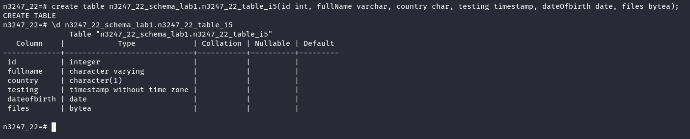

### 6 – TẠO BẢNG VỚI DEFAULT VÀ INTERVAL

- Tạo bảng với DEFAULT và INTERVAL

```sql
CREATE TABLE n3247_22_schema_lab1.n3247_22_table_i6(
    number INTEGER DEFAULT 0,
    livestream INTERVAL
);
```

Giải thích:

- `CREATE TABLE`: Lệnh tạo bảng mới.
- `n3247_22_schema_lab1`: Schema chứa bảng.
- `n3247_22_table_i6`: Tên bảng được tạo.
- `number INTEGER DEFAULT 0`: Cột kiểu số nguyên, có giá trị mặc định bằng `0` nếu không được cung cấp giá trị khi thêm bản ghi.
- `livestream INTERVAL`: Cột lưu khoảng thời gian, ví dụ `2 days`, `3 hours`, `30 minutes`.

- Kiểm tra cấu trúc bảng

```
\d n3247_22_schema_lab1.n3247_22_table_i6
```

- `\d`: Hiển thị cấu trúc bảng.
- `n3247_22_schema_lab1`: Schema chứa bảng.
- `n3247_22_table_i6`: Bảng cần kiểm tra.

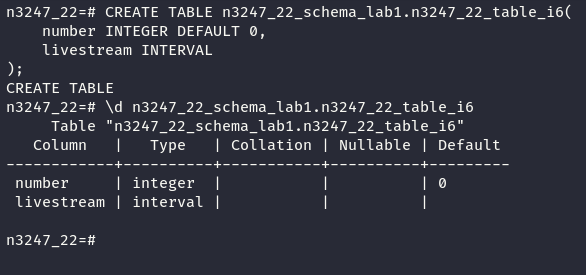

### 7 – TẠO KIỂU DỮ LIỆU TỔNG HỢP (COMPOSITE TYPE)

Tạo một kiểu dữ liệu tổng hợp:

```sql
CREATE TYPE n3247_22_schema_lab1.n3247_22_type AS (
    oldprice REAL,
    newprice REAL,
    dateofbirth DATE,
    files BYTEA
);
```

Giải thích:

- `CREATE TYPE`: Lệnh tạo kiểu dữ liệu tùy chỉnh.
- `n3247_22_schema_lab1`: Schema chứa kiểu dữ liệu.
- `n3247_22_type`: Tên kiểu dữ liệu tổng hợp.
- `AS (...)`: Khai báo các thuộc tính của kiểu dữ liệu tổng hợp.

| Thuộc tính    | Kiểu dữ liệu | Ý nghĩa                             |
| ------------- | ------------ | ----------------------------------- |
| `oldprice`    | `REAL`       | Lưu giá trị số thực, ví dụ giá cũ.  |
| `newprice`    | `REAL`       | Lưu giá trị số thực, ví dụ giá mới. |
| `dateofbirth` | `DATE`       | Lưu ngày, tháng, năm.               |
| `files`       | `BYTEA`      | Lưu dữ liệu nhị phân.               |

- Kiểm tra danh sách kiểu dữ liệu

```
\dT n3247_22_schema_lab1.*
```

Giải thích:

- `\dT`: Liệt kê các kiểu dữ liệu.
- `n3247_22_schema_lab1`: Schema cần kiểm tra.
- `.*`: Hiển thị tất cả kiểu dữ liệu phù hợp trong Schema đó.

- Để xem các thuộc tính bên trong kiểu dữ liệu tổng hợp, sử dụng:

```
\d n3247_22_schema_lab1.n3247_22_type
```

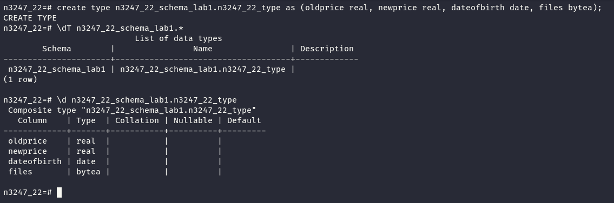

### 8 – TẠO KIỂU DỮ LIỆU LIỆT KÊ (ENUM)

- Tạo kiểu dữ liệu ENUM

```sql
CREATE TYPE n3247_22_schema_lab1.n3247_22_enum
AS ENUM ('big', 'medium', 'small');
```

Giải thích:

- `CREATE TYPE`: Tạo kiểu dữ liệu tùy chỉnh.
- `n3247_22_schema_lab1`: Schema chứa kiểu dữ liệu.
- `n3247_22_enum`: Tên kiểu dữ liệu ENUM.
- `AS ENUM`: Khai báo kiểu dữ liệu liệt kê.
- `'big'`: Kích thước lớn.
- `'medium'`: Kích thước trung bình.
- `'small'`: Kích thước nhỏ.

> Kiểu ENUM chỉ cho phép sử dụng các giá trị đã được khai báo.

- Kiểm tra danh sách kiểu dữ liệu

```
\dT n3247_22_schema_lab1.*
```

Giải thích:

- `\dT`: Liệt kê các kiểu dữ liệu.
- `n3247_22_schema_lab1`: Schema cần kiểm tra.
- `*`: Hiển thị tất cả kiểu dữ liệu phù hợp.

- Kiểm tra các giá trị ENUM

```sql
SELECT unnest(enum_range(NULL::n3247_22_schema_lab1.n3247_22_enum));
```

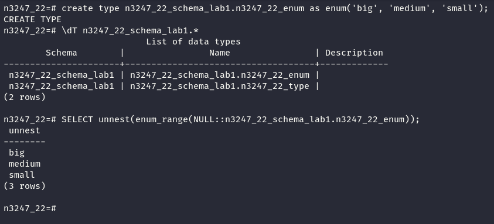

### 9 – TẠO DOMAIN

- Tạo Domain với ràng buộc CHECK

```sql
CREATE DOMAIN n3247_22_schema_lab1.n3247_22_domain
AS INTEGER
CHECK (VALUE >= 100 AND VALUE <= 999);
```

Giải thích:

- `CREATE DOMAIN`: Lệnh tạo một miền dữ liệu tùy chỉnh.
- `n3247_22_schema_lab1`: Schema chứa Domain.
- `n3247_22_domain`: Tên Domain được tạo.
- `AS INTEGER`: Sử dụng kiểu dữ liệu số nguyên.
- `CHECK`: Thiết lập điều kiện kiểm tra giá trị.
- `VALUE`: Đại diện cho giá trị được gán vào Domain.
- `VALUE >= 100`: Giá trị phải lớn hơn hoặc bằng 100.
- `AND`: Toán tử logic yêu cầu cả hai điều kiện đều đúng.
- `VALUE <= 999`: Giá trị phải nhỏ hơn hoặc bằng 999.

Như vậy, Domain chỉ chấp nhận các số nguyên dương có đúng 3 chữ số, từ `100` đến `999`, ngoài ra mặc định vẫn cho phép `NULL`.

- Kiểm tra danh sách Domain

```sql
\dD n3247_22_schema_lab1.*
```

Giải thích:

- `\dD`: Liệt kê các Domain trong PostgreSQL.
- `n3247_22_schema_lab1`: Schema cần kiểm tra.
- `*`: Hiển thị tất cả Domain phù hợp trong Schema.

Các trường thông tin:

| Trường      | Ý nghĩa                           |
| ----------- | --------------------------------- |
| `Schema`    | Schema chứa Domain.               |
| `Name`      | Tên Domain.                       |
| `Type`      | Kiểu dữ liệu cơ sở (`INTEGER`).   |
| `Collation` | Quy tắc so sánh và sắp xếp ký tự. |
| `Nullable`  | Ràng buộc cho phép giá trị NULL.  |
| `Default`   | Giá trị mặc định.                 |
| `Check`     | Điều kiện kiểm tra dữ liệu.       |

- Kiểm tra điều kiện Domain

```
SELECT 123::n3247_22_schema_lab1.n3247_22_domain;
```

-> Hợp lệ vì `123` có đúng 3 chữ số.

```
SELECT 99::n3247_22_schema_lab1.n3247_22_domain;
```

-> Báo lỗi vì `99` nhỏ hơn `100`, không thỏa mãn điều kiện `CHECK`.

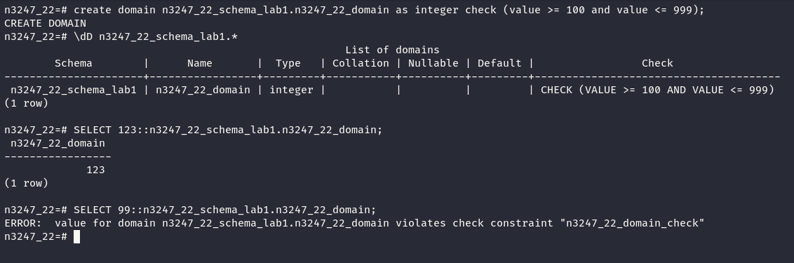

### 10 – TẠO SEQUENCE

- Tạo Sequence

```sql
CREATE SEQUENCE n3247_22_schema_lab1.n3247_22_seq
AS INTEGER
INCREMENT -1
MAXVALUE 1000
START 1000;
```

Giải thích:

- `CREATE SEQUENCE`: Lệnh tạo một đối tượng sinh dãy số tự động.
- `n3247_22_schema_lab1`: Schema chứa Sequence.
- `n3247_22_seq`: Tên Sequence được tạo.
- `AS INTEGER`: Xác định kiểu dữ liệu của dãy số là số nguyên.
- `INCREMENT -1`: Mỗi lần sinh giá trị mới sẽ giảm đi 1.
- `MAXVALUE 1000`: Thiết lập giá trị lớn nhất của dãy là 1000.
- `START 1000`: Thiết lập giá trị khởi đầu là 1000.

- Lấy giá trị tiếp theo của Sequence

```sql
SELECT nextval('n3247_22_schema_lab1.n3247_22_seq');
```

Giải thích:

- `SELECT`: Truy vấn dữ liệu.
- `nextval()`: Hàm lấy giá trị tiếp theo từ Sequence và cập nhật trạng thái của dãy.
- `'n3247_22_schema_lab1.n3247_22_seq'`: Tên Sequence cần lấy giá trị.


- Kiểm tra danh sách Sequence

```
\ds n3247_22_schema_lab1.*
```

Trong đó:

- `\ds`: Hiển thị danh sách Sequence.
- `n3247_22_schema_lab1`: Schema cần kiểm tra.
- `*`: Hiển thị tất cả Sequence trong Schema đó.

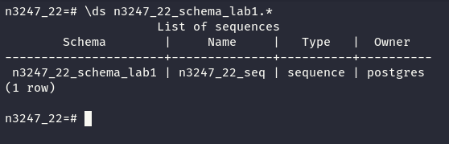

Để xem thông tin chi tiết:

```
\d n3247_22_schema_lab1.n3247_22_seq
```

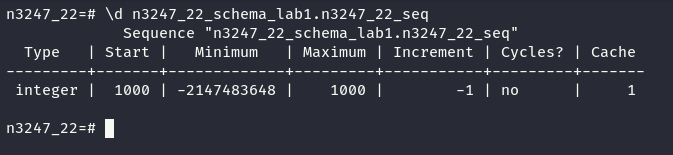

### 11  TẠO INDEX ĐƠN

Trong phần này, sử dụng bảng đã tạo ở bước 5:

```sql
CREATE INDEX n3247_22_idx1
ON n3247_22_schema_lab1.n3247_22_table_i5(id);
```

Giải thích:

- `CREATE INDEX`: Lệnh tạo chỉ mục nhằm hỗ trợ tăng tốc độ truy vấn dữ liệu.
- `n3247_22_idx1`: Tên Index được tạo.
- `ON`: Chỉ định bảng cần tạo Index.
- `n3247_22_schema_lab1`: Schema chứa bảng.
- `n3247_22_table_i5`: Bảng đã tạo ở nhiệm vụ 5.
- `(id)`: Cột được đánh Index, có kiểu dữ liệu `INTEGER`.

PostgreSQL mặc định sử dụng phương pháp B-tree khi tạo Index mà không chỉ định phương pháp khác.

- Kiểm tra Index

Để kiểm tra Index vừa tạo, sử dụng:

```
\d n3247_22_schema_lab1.n3247_22_table_i5
```

Liệt kê các Index trong Schema:

```
\di n3247_22_schema_lab1.*
```

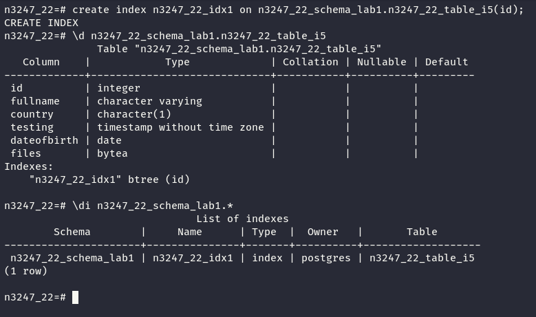

### 12 – TẠO INDEX KẾT HỢP (COMPOSITE INDEX)

```sql
CREATE INDEX n3247_22_idx2
ON n3247_22_schema_lab1.n3247_22_table_i5(id, dateofbirth);
```

Giải thích:

- `CREATE INDEX`: Lệnh tạo chỉ mục nhằm hỗ trợ tăng tốc độ truy vấn dữ liệu.
- `n3247_22_idx2`: Tên Index được tạo.
- `ON`: Chỉ định bảng cần tạo Index.
- `n3247_22_schema_lab1`: Schema chứa bảng.
- `n3247_22_table_i5`: Bảng đã tạo ở nhiệm vụ 5.
- `id`: Cột thứ nhất, có kiểu dữ liệu `INTEGER`.
- `dateofbirth`: Cột thứ hai, có kiểu dữ liệu `DATE`.

Composite Index là chỉ mục được xây dựng trên nhiều cột, giúp tối ưu một số truy vấn sử dụng đồng thời các cột đó.

PostgreSQL mặc định sử dụng phương pháp B-tree.

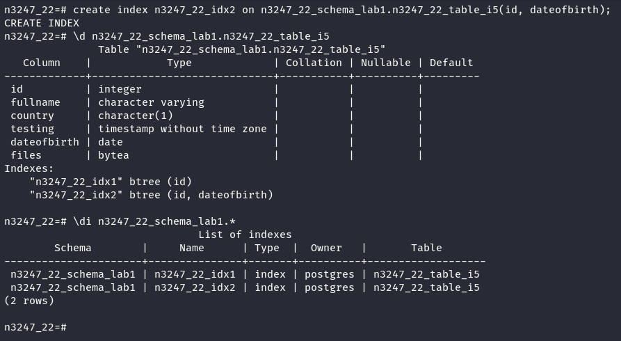

### 13 – TẠO INDEX THEO BIỂU THỨC (EXPRESSION INDEX)

```sql
CREATE INDEX n3247_22_idx3
ON n3247_22_schema_lab1.n3247_22_table_i5(mod(id, 10));
```

Giải thích:

- `CREATE INDEX`: Lệnh tạo chỉ mục nhằm hỗ trợ tăng tốc độ truy vấn.
- `n3247_22_idx3`: Tên Index được tạo.
- `ON`: Chỉ định bảng cần tạo Index.
- `n3247_22_schema_lab1`: Schema chứa bảng.
- `n3247_22_table_i5`: Bảng đã tạo ở nhiệm vụ 5.
- `mod(id, 10)`: Biểu thức tính phần dư khi chia giá trị cột `id` cho `10`.

Expression Index là chỉ mục được xây dựng dựa trên kết quả của một biểu thức hoặc hàm thay vì trực tiếp trên giá trị của cột.

Ví dụ:

| id   | mod(id, 10) |
| ---- | ----------- |
| 123  | 3           |
| 256  | 6           |
| 789  | 9           |
| 1000 | 0           |

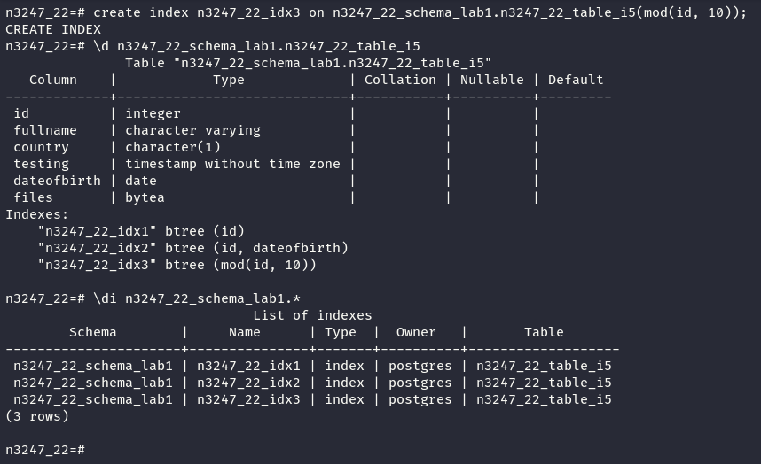

### 14 – TẠO INDEX MỘT PHẦN (PARTIAL INDEX)

```sql
CREATE INDEX n3247_22_idx4
ON n3247_22_schema_lab1.n3247_22_table_i5(id)
WHERE (id >= 100 AND id <= 1000);
```

Giải thích:

- `CREATE INDEX`: Lệnh tạo chỉ mục nhằm hỗ trợ tăng tốc độ truy vấn dữ liệu.
- `n3247_22_idx4`: Tên Index được tạo.
- `ON`: Chỉ định bảng cần tạo Index.
- `n3247_22_schema_lab1`: Schema chứa bảng.
- `n3247_22_table_i5`: Bảng đã tạo ở nhiệm vụ 5.
- `(id)`: Cột được đánh Index, có kiểu dữ liệu `INTEGER`.
- `WHERE`: Xác định điều kiện để một bản ghi được đưa vào Index.
- `id >= 100`: Chỉ lấy giá trị lớn hơn hoặc bằng 100.
- `AND`: Toán tử logic yêu cầu cả hai điều kiện đều đúng.
- `id <= 1000`: Chỉ lấy giá trị nhỏ hơn hoặc bằng 1000.

Partial Index là chỉ mục chỉ chứa các bản ghi thỏa mãn điều kiện được xác định bởi mệnh đề `WHERE`.

Ví dụ:

| Giá trị `id` | Có trong Partial Index? |
| ------------ | ----------------------- |
| 50           | Không                   |
| 99           | Không                   |
| 100          | Có                      |
| 500          | Có                      |
| 1000         | Có                      |
| 1001         | Không                   |

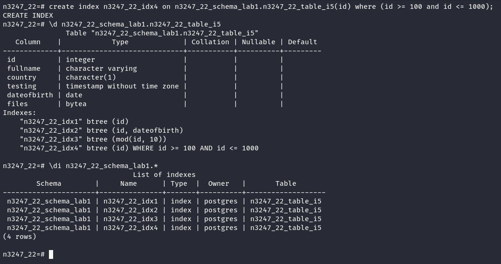

## 5. THỰC HÀNH RÀNG BUỘC DỮ LIỆU

Các bảng trong phần này có cấu trúc và kiểu dữ liệu tương tự bảng ở bước 5, nhưng được bổ sung những ràng buộc khác nhau.

### 🔹 BƯỚC 15 – RÀNG BUỘC NOT NULL

Tạo bảng:

`mã_nhóm_số_thứ_tự_notnull`

Yêu cầu:

- Cấu trúc bảng tương tự bước 5.
- Thuộc tính kiểu `CHAR` phải có ràng buộc `NOT NULL`.

Mục tiêu là đảm bảo cột dữ liệu bắt buộc phải có giá trị khi thêm hoặc cập nhật bản ghi.

### 🔹 BƯỚC 16 – RÀNG BUỘC UNIQUE

Tạo bảng:

`mã_nhóm_số_thứ_tự_unique`

Yêu cầu:

- Cấu trúc bảng tương tự bước 5.
- Thiết lập ràng buộc `UNIQUE` trên tổ hợp hai thuộc tính:
  - CHAR
  - INTEGER

Mục tiêu là đảm bảo không có hai bản ghi có cùng tổ hợp giá trị trên hai cột được chỉ định.

### 🔹 BƯỚC 17 – RÀNG BUỘC PRIMARY KEY

Tạo bảng:

`mã_nhóm_số_thứ_tự_pk`

Yêu cầu:

- Cấu trúc bảng tương tự bước 5.
- Thiết lập khóa chính (`PRIMARY KEY`) trên thuộc tính kiểu `INTEGER`.

Mục tiêu là đảm bảo mỗi bản ghi có một giá trị định danh duy nhất và không được NULL.

### 🔹 BƯỚC 18 – RÀNG BUỘC CHECK

Tạo bảng:

`mã_nhóm_số_thứ_tự_check`

Yêu cầu:

- Cấu trúc bảng tương tự bước 5.
- Thiết lập ràng buộc `CHECK` trên thuộc tính kiểu `VARCHAR`.
- Giá trị của thuộc tính phải chứa ký tự `a`.

Mục tiêu là thực hành kiểm tra tính hợp lệ của dữ liệu trước khi được lưu vào bảng.

---

## 6. TẠO VIEW

### 🔹 BƯỚC 19 – TẠO KHUNG NHÌN (VIEW)

Tạo View với tên:

`mã_nhóm_số_thứ_tự_view`

Yêu cầu:

- Nguồn dữ liệu được lấy từ bảng ở bước 5.
- View chỉ hiển thị hai thuộc tính có kiểu dữ liệu:
  - VARCHAR
  - DATE

Mục tiêu là tìm hiểu cách tạo một khung nhìn để truy xuất một phần dữ liệu của bảng mà không cần tạo bảng lưu trữ dữ liệu độc lập.

---

## 7. KẾT QUẢ MONG ĐỢI

Sau khi hoàn thành bài LAB:

- Kết nối thành công PostgreSQL thông qua `psql`.
- Tạo được Database và Schema theo đúng quy tắc đặt tên.
- Tạo các bảng với đầy đủ kiểu dữ liệu được yêu cầu.
- Xây dựng được Composite Type, ENUM và Domain.
- Tạo Sequence với giá trị bắt đầu và bước thay đổi xác định.
- Tạo thành công bốn loại Index khác nhau.
- Thiết lập được các ràng buộc NOT NULL, UNIQUE, PRIMARY KEY và CHECK.
- Tạo View để truy xuất những thuộc tính được chỉ định.
- Hiểu được cách tổ chức và quản lý các đối tượng cơ bản trong PostgreSQL.

---

## 8. KIẾN THỨC ĐẠT ĐƯỢC

Thông qua bài thực hành này, chúng ta có thể:

1. **Quản lý cấu trúc cơ sở dữ liệu:** Tạo và tổ chức Database, Schema và Table.
2. **Làm việc với kiểu dữ liệu:** Sử dụng các kiểu dữ liệu có sẵn và tự định nghĩa kiểu dữ liệu mới.
3. **Tối ưu truy vấn:** Hiểu cách tạo chỉ mục đơn, chỉ mục kết hợp, chỉ mục theo biểu thức và chỉ mục có điều kiện.
4. **Đảm bảo tính toàn vẹn dữ liệu:** Áp dụng các ràng buộc để kiểm soát dữ liệu hợp lệ.
5. **Quản lý việc truy xuất dữ liệu:** Sử dụng View để biểu diễn những thông tin cần thiết từ bảng.

---

## 9. KẾT LUẬN

Bài LAB **PostgreSQL Basic Database Structures Creation** giúp củng cố kiến thức nền tảng về thiết kế và quản trị cơ sở dữ liệu quan hệ.

Việc thực hành các thao tác tạo Database, Schema, Table, Data Type, Sequence, Index, Constraint và View là cơ sở để tiếp tục nghiên cứu những nội dung nâng cao như:

- Quản trị và bảo mật cơ sở dữ liệu.
- Tối ưu hóa hiệu năng truy vấn SQL.
- Quản lý người dùng và phân quyền truy cập.
- Sao lưu và phục hồi dữ liệu.
- Giám sát và đảm bảo tính toàn vẹn của dữ liệu.
