# POSTGRESQL DATABASE DATA MANIPULATION LAB

## 1. GIỚI THIỆU

Bài thực hành **Thao tác dữ liệu trong cơ sở dữ liệu** tập trung vào việc sử dụng các câu lệnh SQL để thêm, cập nhật, xóa, truy vấn và xử lý dữ liệu trong hệ quản trị cơ sở dữ liệu PostgreSQL.

Thông qua bài thực hành, chúng ta làm quen với các thao tác quản lý dữ liệu, truy vấn dữ liệu từ nhiều bảng, sử dụng các điều kiện lọc, sắp xếp, hàm tổng hợp và truy vấn lồng nhau.

## 2. MỤC TIÊU

- Rèn luyện kỹ năng thao tác với dữ liệu trong cơ sở dữ liệu quan hệ.
- Sử dụng các câu lệnh `INSERT`, `UPDATE`, `DELETE` và `SELECT`.
- Thực hiện truy vấn dữ liệu dựa trên điều kiện và mối quan hệ giữa các bảng.
- Sử dụng các hàm tổng hợp để thống kê và phân tích dữ liệu.
- Áp dụng các kỹ thuật sắp xếp, nhóm dữ liệu và truy vấn con.
- Củng cố kiến thức về ngôn ngữ SQL và hệ quản trị cơ sở dữ liệu PostgreSQL.

## 3. CÔNG CỤ VÀ MÔI TRƯỜNG THỰC HÀNH

| Thành phần | Mô tả |
|---|---|
| Hệ quản trị CSDL | PostgreSQL |
| Ngôn ngữ truy vấn | SQL |
| Hệ điều hành | Ubuntu Linux |
| Công cụ thực hành | PostgreSQL CLI (`psql`) |
| Cơ sở dữ liệu | `n3247_22` |
| Schema | `n3247_22_schema_lab2` |

## 4. NHIỆM VỤ

**Nhiệm vụ 1. Thêm dữ liệu vào các bảng bằng INSERT**

Sử dụng câu lệnh `INSERT` để thêm dữ liệu vào các bảng trong cơ sở dữ liệu.

**Yêu cầu:** Mỗi bảng phải chứa ít nhất **5 bản ghi khác nhau**.

**Nhiệm vụ 2. Cập nhật dữ liệu dựa trên bảng khác**

Sử dụng câu lệnh `UPDATE` để cập nhật các bản ghi trong một bảng dựa trên thông tin của bảng khác.

**Yêu cầu:** Giữa hai bảng phải tồn tại mối quan hệ dữ liệu.

**Nhiệm vụ 3. Xóa dữ liệu dựa trên bảng khác**

Sử dụng câu lệnh `DELETE` để xóa nhiều bản ghi trong một bảng dựa trên thông tin được lưu trữ trong bảng khác.

**Nhiệm vụ 4. Truy vấn một số cột trong bảng**

Sử dụng câu lệnh `SELECT` để hiển thị một số cột được chỉ định thay vì toàn bộ các cột trong bảng.

**Nhiệm vụ 5. Truy vấn dữ liệu theo điều kiện**

Sử dụng câu lệnh `SELECT` kết hợp với mệnh đề `WHERE` để hiển thị những bản ghi thỏa mãn điều kiện xác định.

**Nhiệm vụ 6. Thực hiện tích Descartes của hai bảng**

Thực hiện phép tích Descartes (*Cartesian Product*) giữa hai bảng bằng `CROSS JOIN` hoặc cú pháp tương đương.

**Yêu cầu:** Kết quả chứa tất cả các tổ hợp bản ghi có thể có giữa hai bảng.

**Nhiệm vụ 7. Truy vấn dữ liệu dựa trên điều kiện từ bảng khác**

Truy vấn các bản ghi trong một bảng dựa trên điều kiện được xác định bởi dữ liệu trong bảng khác.

Có thể sử dụng `JOIN`, `IN`, `EXISTS` hoặc truy vấn con tùy theo cấu trúc cơ sở dữ liệu.

**Nhiệm vụ 8. Sử dụng các hàm tổng hợp**

Áp dụng các hàm tổng hợp SQL đối với dữ liệu truy vấn.

Các hàm cần sử dụng:

- `SUM()` – Tính tổng giá trị.
- `AVG()` – Tính giá trị trung bình.
- `MIN()` – Xác định giá trị nhỏ nhất.
- `MAX()` – Xác định giá trị lớn nhất.

**Nhiệm vụ 9. Sắp xếp dữ liệu giảm dần**

Sử dụng mệnh đề `ORDER BY` kết hợp với `DESC` để hiển thị các bản ghi theo thứ tự từ lớn đến nhỏ.

**Nhiệm vụ 10. Sắp xếp tăng dần và giới hạn số bản ghi**

Sử dụng `ORDER BY ASC` để sắp xếp dữ liệu theo thứ tự từ nhỏ đến lớn.

Kết hợp với `LIMIT` để giới hạn số lượng dòng được hiển thị trong kết quả truy vấn.

**Nhiệm vụ 11. Nhóm và tổng hợp dữ liệu bằng GROUP BY**

Sử dụng mệnh đề `GROUP BY` để nhóm các bản ghi theo giá trị của một trường dữ liệu.

Thực hiện tổng hợp dữ liệu trên từng nhóm bằng các hàm tổng hợp SQL.

**Nhiệm vụ 12. Thực hiện truy vấn lồng nhau**

Viết câu lệnh SQL trong đó biểu thức bảng được xác định bởi kết quả của một truy vấn khác.

Sử dụng truy vấn con (*Subquery*) làm nguồn dữ liệu cho truy vấn chính.

## 5. THỰC HÀNH

### Nhiệm vụ 1. Thêm dữ liệu vào các bảng bằng INSERT
Sử dụng câu lệnh INSERT để thêm dữ liệu vào các bảng trong cơ sở dữ liệu.

Yêu cầu: Mỗi bảng phải chứa ít nhất 5 bản ghi khác nhau.

- Tạo bảng students:

```sql
CREATE TABLE IF NOT EXISTS students (
    id_student INT PRIMARY KEY,
    student_name VARCHAR NOT NULL,
    student_group VARCHAR(20) NOT NULL
);
```
- Tạo bảng works:

```sql
CREATE TABLE IF NOT EXISTS works (
    id_work INT PRIMARY KEY,
    work_name VARCHAR(20) NOT NULL,
    student_name VARCHAR NOT NULL
);
```

- Thêm 5 bản ghi vào bảng students:

```sql
INSERT INTO students (id_student, student_name, student_group)
VALUES
(1, 'Ivan', 'N3247'),
(2, 'Petr', 'N3247'),
(3, 'Anna', 'N3248'),
(4, 'Maria', 'N3248'),
(5, 'Alex', 'N3249');
```

- Thêm 5 bản ghi vào bảng works:

```sql
INSERT INTO works (id_work, work_name, student_name)
VALUES
(1, 'Database', 'Ivan'),
(2, 'Network', 'Petr'),
(3, 'Security', 'Anna'),
(4, 'Programming', 'Maria'),
(5, 'Linux', 'Alex');
```

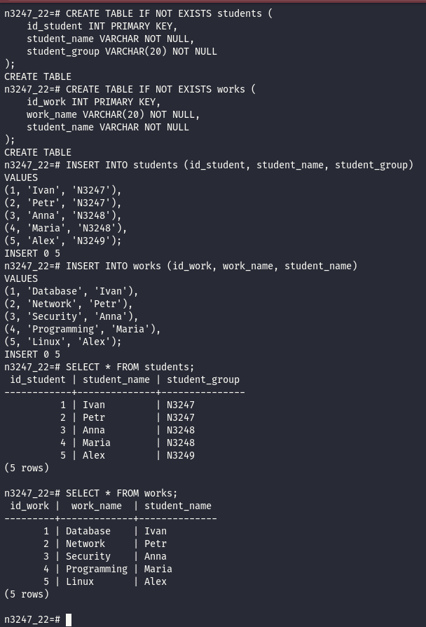

### Nhiệm vụ 2. Cập nhật dữ liệu dựa trên bảng khác
Sử dụng câu lệnh UPDATE để cập nhật các bản ghi trong một bảng dựa trên thông tin của bảng khác.

Yêu cầu: Giữa hai bảng phải tồn tại mối quan hệ dữ liệu.

```sql
UPDATE works AS w
SET work_name = 'Group_Project'
FROM students AS s
WHERE w.student_name = s.student_name
AND s.student_group = 'N3248';
```

| Câu lệnh                                | Giải thích                                                                                          |
| --------------------------------------- | --------------------------------------------------------------------------------------------------- |
| `UPDATE works AS w`                     | Chọn bảng `works` để cập nhật dữ liệu. `w` là bí danh của bảng.                                     |
| `SET work_name = 'Group_Project'`       | Thay đổi giá trị cột `work_name` thành `Group_Project`.                                             |
| `FROM students AS s`                    | Sử dụng dữ liệu từ bảng `students` để xác định những bản ghi cần cập nhật. `s` là bí danh của bảng. |
| `WHERE w.student_name = s.student_name` | Liên kết hai bảng thông qua cột `student_name`. Chỉ xét những bản ghi có tên sinh viên trùng nhau.  |
| `AND s.student_group = 'N3248'`         | Chỉ cập nhật công việc của những sinh viên thuộc nhóm `N3248`.                                      |

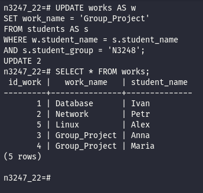

- Cách PostgreSQL thực hiện câu lệnh

Bước 1: PostgreSQL sử dụng bảng `students` để tìm các sinh viên thuộc nhóm `N3248`.

| id_student | student_name | student_group |
| ---------- | ------------ | ------------- |
| 3          | Anna         | N3248         |
| 4          | Maria        | N3248         |

Bước 2: Tìm các bản ghi trong bảng `works` có `student_name` tương ứng với Anna và Maria.

Bước 3: Cập nhật `work_name` của hai sinh viên này thành `Group_Project`.

Minh họa mối quan hệ giữa hai bảng

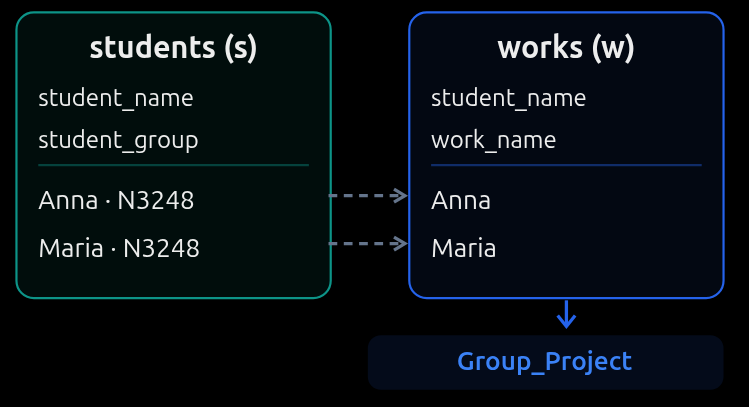

Liên kết qua student_name, lọc nhóm N3248 rồi cập nhật work_name.

### Nhiệm vụ 3. Xóa dữ liệu dựa trên bảng khác
Sử dụng câu lệnh DELETE để xóa nhiều bản ghi trong một bảng dựa trên thông tin được lưu trữ trong bảng khác.

```sql
DELETE FROM works AS w
USING students AS s
WHERE w.student_name = s.student_name
AND s.student_group = 'N3248';
```

- DELETE FROM works AS w: Xóa bản ghi trong bảng works.

- USING students AS s: Sử dụng thông tin từ bảng students.

- WHERE w.student_name = s.student_name: Ghép các bản ghi có cùng tên sinh viên.

- AND s.student_group = 'N3248': Chỉ xóa công việc của sinh viên thuộc nhóm N3248.

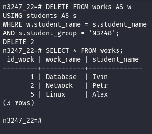

### Nhiệm vụ 4. Truy vấn một số cột trong bảng
Sử dụng câu lệnh SELECT để hiển thị một số cột được chỉ định thay vì toàn bộ các cột trong bảng.

```sql
SELECT student_name, student_group
FROM students;
```

- SELECT: truy vấn dữ liệu

- student_name, student_group: Chỉ định hai cột cần hiển thị

- FROM students: Lấy dữ liệu từ bảng students

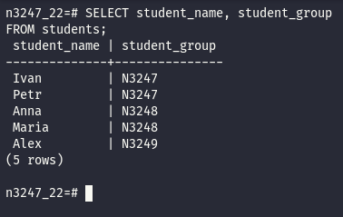

### Nhiệm vụ 5. Truy vấn dữ liệu theo điều kiện
Sử dụng câu lệnh SELECT kết hợp với mệnh đề WHERE để hiển thị những bản ghi thỏa mãn điều kiện xác định.

```sql
SELECT *
FROM students
WHERE student_group = 'N3248';
```

- SELECT *: Lấy tất cả các cột.
- FROM students: Truy vấn dữ liệu từ bảng students.
- WHERE student_group = 'N3248': Chỉ lấy những bản ghi có nhóm là N3248.

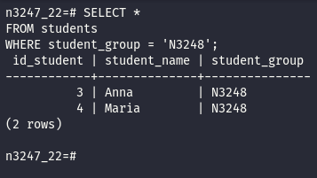

### Nhiệm vụ 6. Thực hiện tích Descartes của hai bảng
Thực hiện phép tích Descartes (Cartesian Product) giữa hai bảng bằng CROSS JOIN hoặc cú pháp tương đương.

Yêu cầu: Kết quả chứa tất cả các tổ hợp bản ghi có thể có giữa hai bảng.

```sql
SELECT *
FROM students
CROSS JOIN works;
```

CROSS JOIN works: Kết hợp mỗi bản ghi trong students với tất cả bản ghi trong works

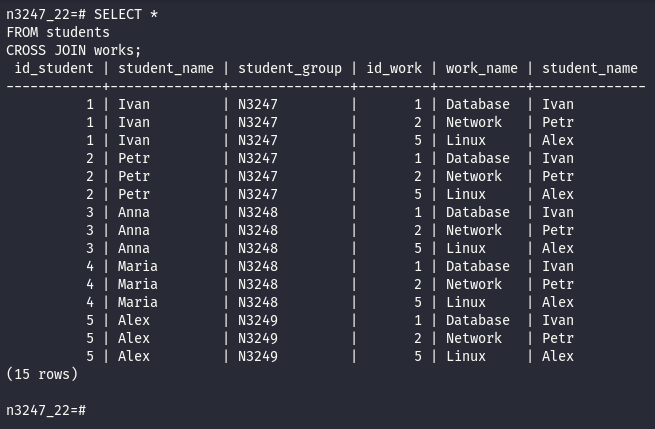

### Nhiệm vụ 7. Truy vấn dữ liệu dựa trên điều kiện từ bảng khác
Truy vấn các bản ghi trong một bảng dựa trên điều kiện được xác định bởi dữ liệu trong bảng khác.

Có thể sử dụng JOIN, IN, EXISTS hoặc truy vấn con tùy theo cấu trúc cơ sở dữ liệu.

```sql
SELECT *
FROM works
WHERE student_name IN (
    SELECT student_name
    FROM students
    WHERE student_group = 'N3247'
);
```

Giải thích:
- Truy vấn con tìm sinh viên thuộc nhóm N3247 trong bảng students.
- Truy vấn chính lấy các công việc tương ứng trong bảng works.
- IN kiểm tra tên sinh viên có thuộc tập kết quả truy vấn con hay không.
- WHERE student_name IN (...): Chỉ lấy những sinh viên có tên thuộc kết quả truy vấn con

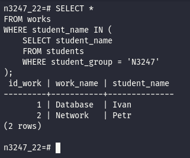

### Nhiệm vụ 8. Sử dụng các hàm tổng hợp
Áp dụng các hàm tổng hợp SQL đối với dữ liệu truy vấn.

Các hàm cần sử dụng:

SUM() – Tính tổng giá trị.
AVG() – Tính giá trị trung bình.
MIN() – Xác định giá trị nhỏ nhất.
MAX() – Xác định giá trị lớn nhất.

```sql
SELECT
    SUM(id_work) AS total,
    AVG(id_work) AS average,
    MIN(id_work) AS minimum,
    MAX(id_work) AS maximum
FROM works;
```
Giải thích
- SUM(id_work): Tính tổng các giá trị ID: 1 + 2 + 5 = 8.
- AVG(id_work): Tính trung bình: 8 / 3 ≈ 2.67.
- MIN(id_work): Giá trị nhỏ nhất là 1.
- MAX(id_work): Giá trị lớn nhất là 5.

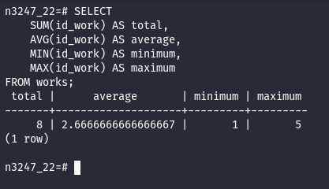

### Nhiệm vụ 9. Sắp xếp dữ liệu giảm dần
Sử dụng mệnh đề ORDER BY kết hợp với DESC để hiển thị các bản ghi theo thứ tự từ lớn đến nhỏ.

```sql
SELECT *
FROM works
ORDER BY id_work DESC;
```

Giải thích
- ORDER BY id_work: Sắp xếp theo cột id_work.
- DESC: Sắp xếp giảm dần, từ giá trị lớn nhất đến nhỏ nhất.

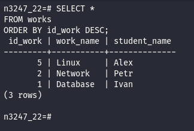

### Nhiệm vụ 10. Sắp xếp tăng dần và giới hạn số bản ghi
Sử dụng ORDER BY ASC để sắp xếp dữ liệu theo thứ tự từ nhỏ đến lớn.

Kết hợp với LIMIT để giới hạn số lượng dòng được hiển thị trong kết quả truy vấn.

```sql
SELECT *
FROM works
ORDER BY id_work ASC
LIMIT 2;
```

Giải thích:

- ORDER BY id_work ASC: Sắp xếp mã công việc tăng dần.

- LIMIT 2: Chỉ lấy 2 bản ghi đầu tiên.

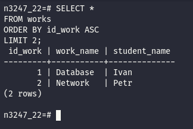

### Nhiệm vụ 11. Nhóm và tổng hợp dữ liệu bằng GROUP BY
Sử dụng mệnh đề GROUP BY để nhóm các bản ghi theo giá trị của một trường dữ liệu.

Thực hiện tổng hợp dữ liệu trên từng nhóm bằng các hàm tổng hợp SQL.

```sql
SELECT
    student_group,
    COUNT(*) AS total_students
FROM students
GROUP BY student_group
ORDER BY student_group;
```

Giải thích:

- COUNT(*): Đếm số sinh viên trong mỗi nhóm
- AS total_students: Đặt tên cho cột kết quả
- GROUP BY student_group: Gom các sinh viên có cùng nhóm
- ORDER BY student_group: Sắp xếp kết quả theo tên nhóm

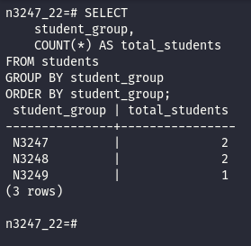

### Nhiệm vụ 12. Thực hiện truy vấn lồng nhau
Viết câu lệnh SQL trong đó biểu thức bảng được xác định bởi kết quả của một truy vấn khác.

Sử dụng truy vấn con (Subquery) làm nguồn dữ liệu cho truy vấn chính.

```sql
SELECT *
FROM (
    SELECT
        student_group,
        COUNT(*) AS total_students
    FROM students
    GROUP BY student_group
) AS group_statistics
WHERE total_students >= 2;
```

Giải thích:

- Truy vấn con: Đếm số sinh viên trong từng nhóm bằng COUNT(*) và GROUP BY.
- AS group_statistics: Đặt bí danh cho bảng kết quả của truy vấn con.
- Truy vấn chính: Lọc các nhóm có từ 2 sinh viên trở lên bằng WHERE total_students >= 2.

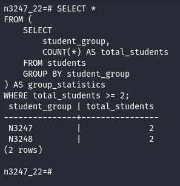
