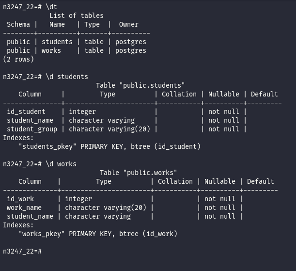
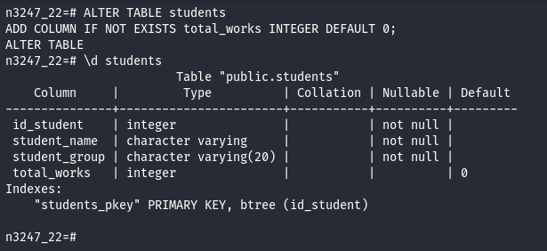
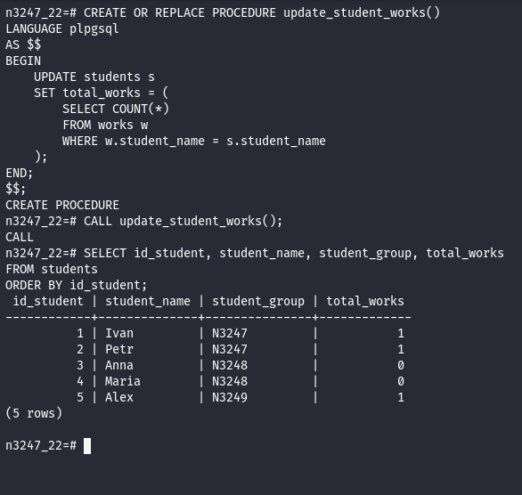

# 3_POSTGRESQL_DATABASE_FUNCTIONS_AND_TRIGGERS_LAB

## 1. GIỚI THIỆU

>HÀM, THỦ TỤC VÀ TRIGGER TRONG POSTGRESQL

## 2. MỤC TIÊU

Rèn luyện kỹ năng xây dựng và sử dụng thủ tục (Procedure), hàm (Function) và trigger trong cơ sở dữ liệu PostgreSQL.

- Viết và thực thi các thủ tục xử lý dữ liệu.
- Sử dụng các hàm tổng hợp để tính toán dữ liệu trong bảng.
- Xây dựng trigger tự động thực hiện các thao tác khi dữ liệu thay đổi.
- Tự động phân loại và chuyển dữ liệu vào các bảng tương ứng.
- Thay thế dữ liệu đầu vào dựa trên bảng từ điển có sẵn.
- Áp dụng các phép tính và thuật toán để xử lý dữ liệu trong cơ sở dữ liệu.

## 3. NHIỆM VỤ 

**Nhiệm vụ 1: Xây dựng thủ tục tổng hợp và cập nhật dữ liệu**
Viết một thủ tục thực hiện tổng hợp (Aggregation) các giá trị trong một bảng và cập nhật kết quả vào một bảng khác.

Thủ tục phải bảo đảm rằng:

- Đọc dữ liệu từ bảng nguồn.
- Thực hiện các phép tổng hợp dữ liệu, chẳng hạn như `SUM()`, `COUNT()`, `AVG()`, `MIN()` hoặc `MAX()`.
- Cập nhật các giá trị tổng hợp vào bảng đích.
- Khi người dùng gọi thủ tục, thông tin trong bảng đích được cập nhật theo dữ liệu hiện tại của bảng nguồn.

**Nhiệm vụ 2: Xây dựng trigger tự động cập nhật dữ liệu tổng hợp**

Viết một trigger thực hiện tự động thao tác tổng hợp và cập nhật dữ liệu đã xây dựng ở Nhiệm vụ 1 khi có bản ghi mới được thêm vào bảng nguồn.

Trigger phải bảo đảm rằng:

- Được kích hoạt tự động khi thực hiện thao tác `INSERT` vào bảng nguồn.
- Thực hiện cập nhật dữ liệu tổng hợp trong bảng đích.
- Không yêu cầu người dùng phải gọi thủ tục cập nhật theo cách thủ công.
- Dữ liệu tổng hợp được duy trì chính xác sau mỗi lần thêm bản ghi mới.

**Nhiệm vụ 3: Xây dựng trigger phân loại dữ liệu theo ngày**

Viết một trigger sử dụng giá trị ngày tháng của bản ghi được thêm vào để tự động chuyển bản ghi đó vào bảng tương ứng.

Trigger phải bảo đảm rằng:

- Kiểm tra giá trị ngày tháng của bản ghi mới.
- Xác định bảng đích phù hợp dựa trên ngày tháng.
- Tự động thêm bản ghi vào bảng tương ứng.
- Bảo đảm dữ liệu được phân loại chính xác theo điều kiện đã thiết lập.

**Nhiệm vụ 4: Xây dựng trigger thay thế giá trị theo bảng từ điển**

Viết một trigger thực hiện thay thế giá trị của bản ghi được thêm vào dựa trên bảng từ điển (Dictionary Table) đã tồn tại.

Trigger phải bảo đảm rằng:

- Đọc giá trị của bản ghi mới trước khi lưu vào bảng.
- Kiểm tra giá trị đó trong bảng từ điển.
- Xác định giá trị thay thế tương ứng theo dữ liệu từ điển.
- Tự động thay thế giá trị đầu vào trước khi hoàn tất thao tác thêm bản ghi.

**Nhiệm vụ 5: Xây dựng thủ tục tính tổng các giá trị tại vị trí tỷ lệ vàng**

Viết một thủ tục tính và xuất tổng các giá trị của những bản ghi trong bảng, bao gồm:

- Giá trị của bản ghi đầu tiên.
- Giá trị của bản ghi cuối cùng.
- Giá trị của các bản ghi nằm tại những vị trí tương ứng với tỷ lệ vàng (Golden Ratio).

Thủ tục phải bảo đảm rằng:

- Xác định tổng số bản ghi trong bảng.
- Xác định thứ tự các bản ghi dựa trên tiêu chí sắp xếp rõ ràng.
- Tính toán các vị trí liên quan đến tỷ lệ vàng.
- Truy xuất giá trị của các bản ghi tại những vị trí đã xác định.
- Tính tổng và xuất kết quả cho người dùng.

## 4. KIẾN THỨC SỬ DỤNG

| Thành phần | Chức năng |
|---|---|
| `CREATE PROCEDURE` | Tạo thủ tục trong PostgreSQL |
| `CALL` | Gọi và thực thi thủ tục |
| `CREATE FUNCTION` | Tạo hàm xử lý và trả về kết quả |
| `RETURNS TRIGGER` | Khai báo hàm được sử dụng bởi trigger |
| `CREATE TRIGGER` | Tạo trigger tự động thực hiện thao tác |
| `BEFORE INSERT` | Kích hoạt trigger trước khi thêm bản ghi |
| `AFTER INSERT` | Kích hoạt trigger sau khi thêm bản ghi |
| `NEW` | Truy cập dữ liệu của bản ghi mới trong trigger |
| `INSERT INTO` | Thêm dữ liệu vào bảng |
| `UPDATE` | Cập nhật dữ liệu trong bảng |
| `SELECT` | Truy vấn và lấy dữ liệu |
| `SUM()` | Tính tổng các giá trị |
| `COUNT()` | Đếm số lượng bản ghi |
| `AVG()` | Tính giá trị trung bình |
| `ORDER BY` | Sắp xếp và xác định thứ tự bản ghi |
| `PL/pgSQL` | Ngôn ngữ lập trình thủ tục của PostgreSQL |

## 5. THỰC HÀNH

### Nhiệm vụ 1: Xây dựng thủ tục tổng hợp và cập nhật dữ liệu Viết một thủ tục thực hiện tổng hợp (Aggregation) các giá trị trong một bảng và cập nhật kết quả vào một bảng khác.

Ta có các bảng và cấu trúc như sau:



Ta thêm cột lưu kết quả tổng hợp:

```sql
ALTER TABLE students
ADD COLUMN IF NOT EXISTS total_works INTEGER DEFAULT 0;
```

Giải thích

- ALTER TABLE students: Thay đổi cấu trúc bảng students.
- ADD COLUMN: Thêm một cột mới vào bảng.
- IF NOT EXISTS: Chỉ thêm cột nếu cột chưa tồn tại, tránh phát sinh lỗi khi thực thi lại.
- total_works: Tên cột dùng để lưu tổng số bài thực hành của mỗi sinh viên.
- INTEGER: Kiểu dữ liệu số nguyên.
- DEFAULT 0: Thiết lập giá trị mặc định bằng 0 nếu không cung cấp giá trị khi thêm bản ghi.

Mục đích: Tạo cột total_works trong bảng students để lưu kết quả tổng hợp từ bảng works.



Tạo Procedure:

```sql
CREATE OR REPLACE PROCEDURE update_student_works()
LANGUAGE plpgsql
AS $$
BEGIN
    UPDATE students s
    SET total_works = (
        SELECT COUNT(*)
        FROM works w
        WHERE w.student_name = s.student_name
    );
END;
$$;
```

Giải thích:
- CREATE OR REPLACE PROCEDURE: Tạo thủ tục mới hoặc thay thế thủ tục đã tồn tại.
- update_student_works(): Tên thủ tục, không có tham số đầu vào.
- LANGUAGE plpgsql: Xác định ngôn ngữ lập trình PL/pgSQL của PostgreSQL.
- AS $$ ... $$: Đánh dấu phần nội dung của thủ tục.
- BEGIN ... END: Xác định khối lệnh được thực thi.
- UPDATE students s: Cập nhật dữ liệu trong bảng students, sử dụng bí danh s.
- SET total_works = (...): Gán giá trị mới cho cột total_works.
- SELECT COUNT(*): Đếm số bản ghi thỏa mãn điều kiện.
- FROM works w: Lấy dữ liệu từ bảng works, sử dụng bí danh w.
- WHERE w.student_name = s.student_name: Chỉ đếm các bài thực hành có tên sinh viên trùng với sinh viên đang được cập nhật.
Nguyên lý hoạt động: Với mỗi sinh viên trong bảng students, thủ tục đếm số bài thực hành tương ứng trong bảng works, sau đó cập nhật kết quả vào cột total_works. Nếu không có bài thực hành nào, kết quả là 0.

Thực thi Procedure:

```sql
CALL update_student_works();
```

- CALL: Lệnh gọi và thực thi thủ tục trong PostgreSQL.
- update_student_works(): Thủ tục đã tạo ở bước trước.

Kiểm tra:

```sql
SELECT id_student, student_name, student_group, total_works
FROM students
ORDER BY id_student;
```

- SELECT: Truy vấn dữ liệu từ bảng.
- id_student: Hiển thị mã định danh sinh viên.
- student_name: Hiển thị tên sinh viên.
- student_group: Hiển thị nhóm của sinh viên.
- total_works: Hiển thị tổng số bài thực hành đã được cập nhật.
- FROM students: Xác định bảng lấy dữ liệu.
- ORDER BY id_student: Sắp xếp kết quả theo mã sinh viên theo thứ tự tăng dần.


